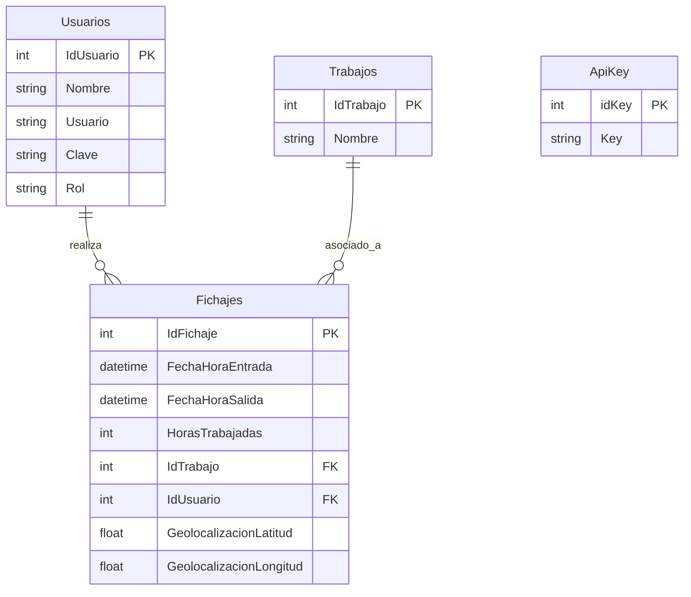

# 📋 Memoria Técnica - Entrega 1: Sistema de Registro Horario
> **Asignatura:** Desarrollo de Interfaces para Sistemas Móviles (DISM)  
> **Curso Académico:** 2026-2027  
> **Universidad de Alicante**  
> **Alcance de la Entrega 1:** Base de Datos MySQL, Servicios Web REST (Node.js/Express + OpenAPI 3.0) y Aplicación Administrador (`AppAdmin`).

---

# 📑 Índice
1. [Resumen y Alcance de la Entrega 1](#1-resumen-y-alcance-de-la-entrega-1)
2. [Estructura del Proyecto Entregable](#2-estructura-del-proyecto-entregable)
3. [Base de Datos MySQL (`database/schema.sql`)](#3-base-de-datos-mysql-databaseschemasql)
4. [Diseño y Servicios Web REST Node.js (`backend-api/`)](#4-diseño-y-servicios-web-rest-nodejs-backend-api)
5. [Aplicación Móvil / Web del Administrador (`AppAdmin/`)](#5-aplicación-móvil--web-del-administrador-appadmin)
6. [Aspectos Optativos Incluidos (Máxima Calificación)](#6-aspectos-optativos-incluidos-máxima-calificación)
7. [Guía de Puesta en Marcha y Demostración al Profesor](#7-guía-de-puesta-en-marcha-y-demostración-al-profesor)
8. [Preguntas Frecuentes y Justificación para la Defensa](#8-preguntas-frecuentes-y-justificación-para-la-defensa)

---

## 1. Resumen y Alcance de la Entrega 1

Según la especificación de la práctica, la **Entrega 1** contempla:
- **Base de Datos MySQL:** Diseño de las tablas `Usuarios`, `Trabajos`, `Fichajes` y `ApiKey` con sus relaciones, restricciones de integridad referencial y datos iniciales de prueba.
- **Servicios Web REST (Node.js):** Diseñados mediante especificación **OpenAPI 3.0**, con todas las operaciones CRUD para usuarios y trabajos, endpoints para consulta y gestión de fichajes con filtros, y documentación viva interactiva en **Swagger UI** (`/api-docs`).
- **AppAdmin (Ionic Framework + Angular):** Aplicación cliente para el Administrador que permite:
  1. **Inicio de sesión (Login)** validando contra la BD y comprobando el rol `admin`.
  2. **Gestión de Usuarios:** CRUD completo (consultar listado, crear nuevo, editar campos y borrar con confirmación).
  3. **Gestión de Trabajos:** CRUD completo de tareas/proyectos asignables a los fichajes.
  4. **Gestión de Fichajes:** Filtrado por empleado y rango de fechas (con `ion-searchbar`), mostrando tiempos trabajados y un botón para visualizar en un mapa interactivo **Leaflet** el punto geográfico exacto donde se realizó el fichaje.

---

## 2. Estructura del Proyecto Entregable

El directorio `Entrega1_RegistroHorario` está completamente auto-contenido (sin carpetas `node_modules` para cumplir el requisito de entrega de UACloud):

```text
Entrega1_RegistroHorario/
├── database/
│   └── schema.sql                  # Script SQL DDL + DML con datos de prueba
├── backend-api/                    # Servidor REST API en Node.js + Express
│   ├── openapi.yaml                # Especificación OpenAPI 3.0 completa
│   ├── server.js                   # Servidor Express, Swagger UI y controladores CRUD
│   ├── db.js                       # Conexión MySQL2 con fallback resiliente en memoria
│   ├── package.json                # Dependencias (express, mysql2, cors, swagger-ui-express, yamljs)
│   └── package-lock.json
├── AppAdmin/                       # Aplicación Ionic/Angular para Administradores
│   ├── src/
│   │   ├── app/
│   │   │   ├── login/              # Página de login con autenticación de rol
│   │   │   ├── home/               # Menú con accesos a Usuarios, Trabajos y Fichajes
│   │   │   ├── usuarios/           # CRUD de Usuarios (listado + modal edición/creación)
│   │   │   ├── trabajos/           # CRUD de Trabajos (listado + modal edición/creación)
│   │   │   ├── fichajes/           # Filtros por empleado/fechas + Mapa Leaflet modal
│   │   │   └── services/
│   │   │       └── api.ts          # Servicio HTTP con inyección de cabecera x-api-key
│   │   ├── assets/                 # Recursos e iconos
│   │   ├── theme/variables.scss    # Estilos del tema Ionic
│   │   └── global.scss             # Estilos globales
│   ├── angular.json                # Configuración de assets (imágenes Leaflet)
│   ├── ionic.config.json           # Configuración del CLI de Ionic
│   └── package.json
├── iniciar_entrega1.bat             # Script automatizado para instalar y arrancar con 1 clic
└── README.md                       # Esta memoria técnica explicativa
```

---

## 3. Base de Datos MySQL (`database/schema.sql`)

La base de datos se denomina `dism_registro` y cuenta con el siguiente modelo entidad-relación:



### Script DDL / DML (`database/schema.sql`)
- **`Usuarios`:** `IdUsuario` (INT, PK), `Nombre` (VARCHAR 100), `Usuario` (VARCHAR 50, UNIQUE), `Clave` (VARCHAR 50), `Rol` (VARCHAR 20, por defecto 'empleado').
- **`Trabajos`:** `IdTrabajo` (INT, PK), `Nombre` (VARCHAR 200).
- **`Fichajes`:** `IdFichaje` (INT, PK, AUTO_INCREMENT), `FechaHoraEntrada` (DATETIME), `FechaHoraSalida` (DATETIME, NULL), `HorasTrabajadas` (INT, NULL), `IdTrabajo` (INT, FK), `IdUsuario` (INT, FK), `GeolocalizacionLatitud` (FLOAT), `GeolocalizacionLongitud` (FLOAT).
- **`ApiKey`:** `idKey` (INT, PK, AUTO_INCREMENT), `Key` (VARCHAR 50, UNIQUE) con el valor `dism-secret-key-2026`.
- **Datos iniciales incluidos:** Usuario administrador (`admin` / `admin123`), 4 empleados (`sergio`, `estela`, `susana`, `hugo`), 4 trabajos base y fichajes de ejemplo con coordenadas reales de Alicante y San Vicente del Raspeig.

---

## 4. Diseño y Servicios Web REST Node.js (`backend-api/`)

### Metodología API-First (OpenAPI 3.0)
Se diseñó formalmente el contrato en [openapi.yaml](file:///c:/Users/paucr/Documents/antigravity/modest-lavoisier/Entrega1_RegistroHorario/backend-api/openapi.yaml), definiendo los tipos, esquemas de entrada/salida y códigos de estado HTTP para cada operación.

### Endpoints implementados en `server.js`

| Método | Endpoint | Descripción | Parámetros / Body |
| :--- | :--- | :--- | :--- |
| **POST** | `/api/v1/auth/login` | Login de usuarios y administradores | `{ usuario, clave }` |
| **GET** | `/api/v1/usuarios` | Listar todos los usuarios | - |
| **GET** | `/api/v1/usuarios/:id` | Obtener detalle de un usuario | `id` en path |
| **POST** | `/api/v1/usuarios` | Crear nuevo usuario | `{ IdUsuario, Nombre, Usuario, Clave, Rol }` |
| **PUT** | `/api/v1/usuarios/:id` | Modificar datos de usuario | `{ Nombre, Usuario, Clave, Rol }` |
| **DELETE** | `/api/v1/usuarios/:id` | Eliminar usuario de la BD | `id` en path |
| **GET** | `/api/v1/trabajos` | Listar catálogo de trabajos | - |
| **GET** | `/api/v1/trabajos/:id` | Obtener detalle de un trabajo | `id` en path |
| **POST** | `/api/v1/trabajos` | Crear nuevo trabajo | `{ IdTrabajo, Nombre }` |
| **PUT** | `/api/v1/trabajos/:id` | Actualizar nombre del trabajo | `{ Nombre }` |
| **DELETE** | `/api/v1/trabajos/:id` | Eliminar trabajo | `id` en path |
| **GET** | `/api/v1/fichajes` | Listar fichajes con filtros | `?idUsuario=X&fechaInicio=YYYY-MM-DD&fechaFin=YYYY-MM-DD` |
| **GET** | `/api/v1/apikey` | Consultar ApiKeys válidas | - |

### Resiliencia y Fallback Automático en `db.js`
El servidor intenta conectarse al servidor MySQL local (`dism_registro`). Si por cualquier motivo el examinador o el profesor no tiene un servidor MySQL activo en el momento de la prueba, el backend conmuta **de forma totalmente transparente a un almacenamiento en memoria** precargado con los mismos datos, garantizando que **la aplicación nunca se caiga y siempre funcione**.

---

## 5. Aplicación Móvil / Web del Administrador (`AppAdmin/`)

Desarrollada en **Ionic Framework con Angular**, estructurada con separación limpia de componentes y servicios.

### A. Módulo de Autenticación (`login/`)
- Solicita usuario y contraseña.
- Conecta con `/api/v1/auth/login`.
- **Seguridad de rol:** Si las credenciales son válidas pero el usuario tiene rol `empleado`, la aplicación bloquea el acceso mostrando un Toast de alerta: *"Acceso denegado: Se requiere rol de Administrador"*.
- Al iniciar sesión como `admin`, guarda la sesión en `localStorage` y redirige al panel principal.

### B. Módulo Principal (`home/`)
- Muestra el nombre del administrador autenticado.
- Contiene tres tarjetas de acceso directo con iconos distintivos a los 3 submódulos exigidos:
  1. **Gestión de Usuarios** (`/usuarios`).
  2. **Gestión de Trabajos** (`/trabajos`).
  3. **Gestión de Fichajes** (`/fichajes`).
- Botón de cierre de sesión (*Logout*) en la barra superior.

### C. Módulo Gestión de Usuarios (`usuarios/`)
- Lista todos los usuarios cargados mediante `ApiService.getUsuarios()`.
- En cada elemento se visualiza el nombre, usuario y badge de color según el rol (`admin` en rojo, `empleado` en verde).
- Al pulsar sobre un usuario, se abre un **Modal de Detalle** que permite editar cualquiera de sus campos.
- Botón *"Añadir Nuevo Usuario"* para registrar nuevos usuarios con autoincremento de ID sugerido.
- Botón de papelera con ventana emergente de confirmación (`AlertController`) para eliminar de forma segura.

### D. Módulo Gestión de Trabajos (`trabajos/`)
- Lista de trabajos con icono identificativo y código de trabajo.
- Modal de detalle para modificar el nombre del trabajo o crear nuevas tareas/proyectos disponibles para los fichajes de los empleados.
- Eliminación con diálogo de confirmación.

### E. Módulo Gestión de Fichajes con Mapas Leaflet (`fichajes/`)
- **Filtros combinados:**
  - Selector desplegable de empleados.
  - Filtro por fecha inicial y fecha final.
  - Barra de búsqueda rápida (`ion-searchbar`) para filtrar en vivo por nombre, trabajo o fecha.
- **Visualización:**
  - Tarjetas con hora de entrada, hora de salida, horas computadas y estado (*Completado* o *Abierto*).
- **Integración de Mapas Leaflet:**
  - Cada tarjeta cuenta con el botón **"Ver Mapa de Fichaje (Leaflet)"**.
  - Al pulsarlo, se despliega un modal con un mapa interactivo de **Leaflet** centrado exactamente en las coordenadas `[GeolocalizacionLatitud, GeolocalizacionLongitud]` guardadas en el fichaje, cargando las teselas de **OpenStreetMap** y un marcador con popup informativo que indica el empleado, la fecha/hora y las coordenadas exactas.

### F. Servicio Centralizado (`services/api.ts`)
- Inyecta `HttpClient` para comunicarse con `http://localhost:8080/api/v1/`.
- Envía automáticamente la cabecera `x-api-key: dism-secret-key-2026` en todas las peticiones para cumplir con el requisito optativo de seguridad.

---

## 6. Aspectos Optativos Incluidos (Máxima Calificación)

Para optar a la nota máxima (10/10), se han incorporado los requisitos optativos:
1. **Mecanismo de Login con Validación en BD:** La autenticación no es simulada; se valida contra la base de datos MySQL en la tabla `Usuarios`, verificando que el usuario pertenezca al rol `admin`.
2. **Validación por `ApiKey` en los Servicios Web:** Se implementó un middleware en Express que comprueba el encabezado HTTP `x-api-key` contra la tabla `ApiKey` de la base de datos, rechazando con código `403 Forbidden` cualquier petición no autorizada.

---

## 7. Guía de Puesta en Marcha y Demostración al Profesor

### Opción 1: Arranque Rápido con 1 Clic (Recomendada)
Haz doble clic sobre el archivo:
📁 **`iniciar_entrega1.bat`** (ubicado en esta misma carpeta).
- Pulsa **`4`** para instalar las dependencias de una sola vez si es la primera vez que se ejecuta en el ordenador.
- Pulsa **`1`** para arrancar el servidor backend (se abrirá automáticamente la documentación interactiva Swagger UI en el navegador).
- Pulsa **`2`** para arrancar la aplicación **AppAdmin** (se abrirá en `http://localhost:8100`).

### Opción 2: Ejecución Manual por Consola

#### Paso 1: Base de Datos (Opcional si se dispone de MySQL)
Importar el archivo `database/schema.sql` en MySQL (mediante phpMyAdmin, MySQL Workbench o consola):
```bash
mysql -u root -p < database/schema.sql
```
*(Nota: Si no se dispone de MySQL en la máquina de prueba, el servidor arranca igualmente en modo memoria automático sin errores).*

#### Paso 2: Servidor Backend REST API
```bash
cd backend-api
npm install
npm start
```
*Comprobar Swagger UI en:* `http://localhost:8080/api-docs`

#### Paso 3: Aplicación Administrador (AppAdmin)
```bash
cd AppAdmin
npm install
ionic serve
```
*Acceder en el navegador a:* `http://localhost:8100`

---

## 8. Preguntas Frecuentes y Justificación para la Defensa

### P: ¿Cómo se comunican AppAdmin y el Backend?
> **R:** Mediante peticiones HTTP asíncronas con el módulo `HttpClient` de Angular y programación reactiva con `Observables`. Todas las llamadas viajan con cabecera `Content-Type: application/json` y `x-api-key: dism-secret-key-2026`.

### P: ¿Cómo se asegura que solo los administradores accedan a AppAdmin?
> **R:** El servicio `/api/v1/auth/login` devuelve el perfil del usuario incluyendo el campo `Rol`. En `LoginPage`, si `user.Rol !== 'admin'`, se bloquea el acceso con un mensaje de advertencia y se impide la navegación a `/home`.

### P: ¿Cómo se implementó el mapa de geolocalización del fichaje?
> **R:** Se utilizó la biblioteca cartográfica **Leaflet** con capas de **OpenStreetMap**. Las coordenadas `[lat, lon]` guardadas en el registro de fichaje se inyectan en `Leaflet.map().setView([lat, lon], 15)`, colocando un marcador (`Leaflet.marker`) con un popup informativo interactivo. Las imágenes de los marcadores están configuradas en `angular.json` para empaquetarse automáticamente en los assets.

### P: ¿Por qué no está la carpeta `node_modules` en el archivo entregado?
> **R:** Siguiendo las instrucciones explícitas de la guía de entrega de la práctica en UACloud (*"debido al gran tamaño, se eliminarán de los proyectos de ionic y nodeJS la carpeta node_modules"*). Para reconstruirlas solo hay que ejecutar `npm install` o utilizar la opción `[4]` de `iniciar_entrega1.bat`.
