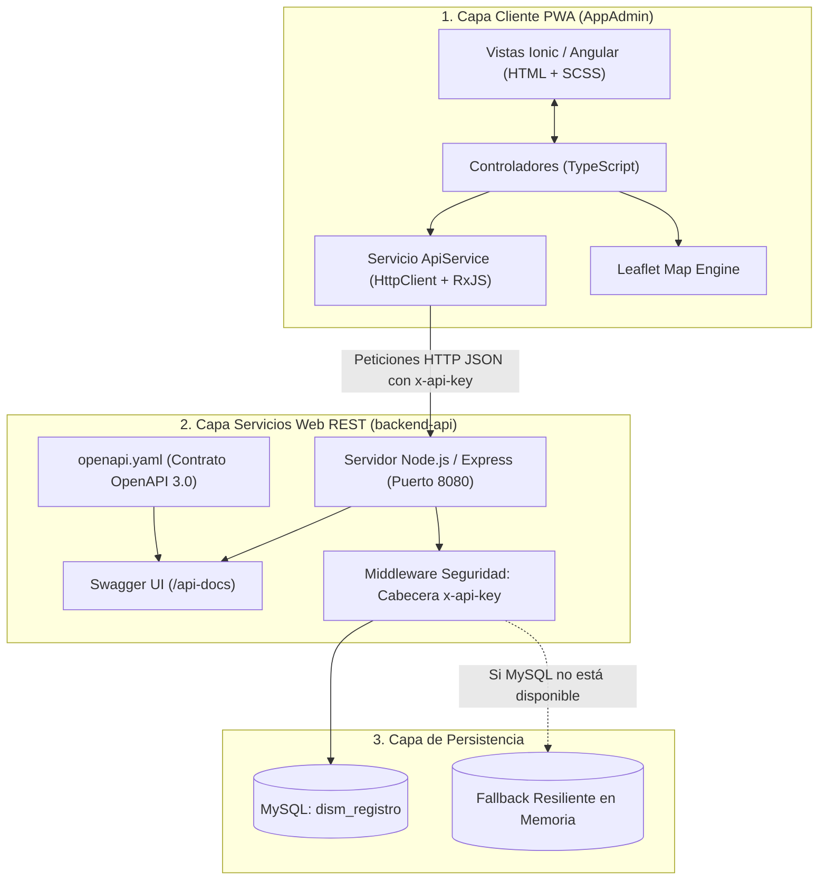
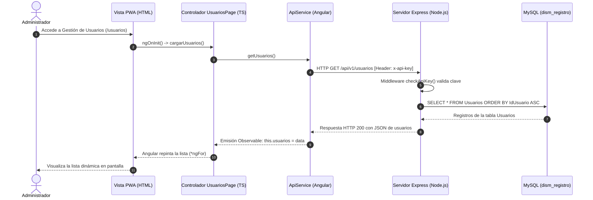
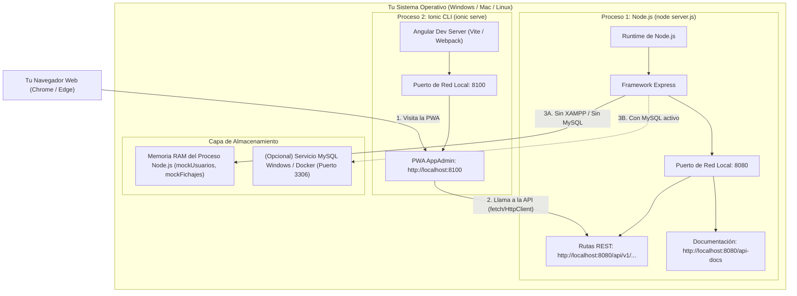

# 📋 MEMORIA TÉCNICA - ENTREGA 1: SISTEMA DE REGISTRO HORARIO
## Aplicación Administrador (PWA `AppAdmin`), Servicios Web REST (OpenAPI 3.0) y Base de Datos MySQL

> **Asignatura:** Desarrollo de Interfaces para Sistemas Móviles (DISM)  
> **Curso Académico:** 2026-2027  
> **Universidad de Alicante**  
> **Ámbito exclusivo:** Entrega 1 (PWA Administrador `AppAdmin`, Backend Node.js / Express con OpenAPI y Base de Datos MySQL).

---

# 📑 ÍNDICE DE CONTENIDOS

1. [VISIÓN GENERAL Y ARQUITECTURA DEL SISTEMA](#1-visión-general-y-arquitectura-del-sistema)
2. [EXPLICACIÓN ARCHIVO A ARCHIVO DE LA PWA (APPADMIN)](#2-explicación-archivo-a-archivo-de-la-pwa-appadmin)
   - 2.1 [Carpeta `login/`](#21-carpeta-login)
   - 2.2 [Carpeta `home/`](#22-carpeta-home)
   - 2.3 [Carpeta `services/`](#23-carpeta-services)
   - 2.4 [Carpeta `usuarios/`](#24-carpeta-usuarios)
   - 2.5 [Carpeta `trabajos/`](#25-carpeta-trabajos)
   - 2.6 [Carpeta `fichajes/`](#26-carpeta-fichajes)
   - 2.7 [Archivos Globales Relevantes de `AppAdmin/`](#27-archivos-globales-relevantes-de-appadmin)
3. [ARCHIVOS Y SCRIPTS DE LA RAÍZ Y DEL BACKEND (NO POR DEFECTO)](#3-archivos-y-scripts-de-la-raíz-y-del-backend-no-por-defecto)
   - 3.1 [`iniciar_entrega1.bat` (Lanzador automático)](#31-iniciar_entrega1bat-lanzador-automático)
   - 3.2 [`database/schema.sql` (Base de datos MySQL)](#32-databaseschemasql-base-de-datos-mysql)
   - 3.3 [`backend-api/db.js` (Conexión y Fallback en Memoria)](#33-backend-apidbjs-conexión-y-fallback-en-memoria)
   - 3.4 [`backend-api/server.js` (Servidor Express y Rutas)](#34-backend-apiserverjs-servidor-express-y-rutas)
4. [CÓMO FUNCIONA OPENAPI 3.0 Y SWAGGER UI](#4-cómo-funciona-openapi-30-y-swagger-ui)
   - 4.1 [Definición del Contrato API-First (`openapi.yaml`)](#41-definición-del-contrato-api-first-openapiyaml)
   - 4.2 [Montaje de Swagger UI en Express con `yamljs`](#42-montaje-de-swagger-ui-en-express-con-yamljs)
   - 4.3 [Cómo se Conecta OpenAPI con la Base de Datos MySQL](#43-cómo-se-conecta-openapi-con-la-base-de-datos-mysql)
   - 4.4 [Sistema de Resiliencia: Fallback Automático si no hay MySQL](#44-sistema-de-resiliencia-fallback-automático-si-no-hay-mysql)
5. [LISTAS DINÁMICAS EN LA PWA (`ion-list` + ANGULAR)](#5-listas-dinámicas-en-la-pwa-ion-list--angular)
   - 5.1 [¿Qué es una Lista Dinámica en Ionic/Angular?](#51-qué-es-una-lista-dinámica-en-ionicangular)
   - 5.2 [Directiva `*ngFor` y Enlace de Datos Reactivo](#52-directiva-ngfor-y-enlace-de-datos-reactivo)
   - 5.3 [Actualización Dinámica al Crear, Editar o Eliminar](#53-actualización-dinámica-al-crear-editar-o-eliminar)
   - 5.4 [Filtrado Dinámico en Tiempo Real (`ion-searchbar`)](#54-filtrado-dinámico-en-tiempo-real-ion-searchbar)
6. [RECOGIDA Y FLUJO DE DATOS DE USUARIOS (DE LA BD A LA PWA)](#6-recogida-y-flujo-de-datos-de-usuarios-de-la-bd-a-la-pwa)
   - 6.1 [Paso a Paso: Desde la Tabla `Usuarios` hasta la Pantalla](#61-paso-a-paso-desde-la-tabla-usuarios-hasta-la-pantalla)
   - 6.2 [Diagrama de Secuencia del Viaje de los Datos](#62-diagrama-de-secuencia-del-viaje-de-los-datos)
   - 6.3 [Autenticación de Login, Validación de Rol Admin y `localStorage`](#63-autenticación-de-login-validación-de-rol-admin-y-localstorage)
7. [DE DÓNDE SE HAN SACADO LOS ICONOS (IONICONS)](#7-de-dónde-se-han-sacado-los-iconos-ionicons)
   - 7.1 [Procedencia: Paquete `ionicons`](#71-procedencia-paquete-ionicons)
   - 7.2 [Configuración en `angular.json` para Empaquetar los SVG](#72-configuración-en-angularjson-para-empaquetar-los-svg)
   - 7.3 [Cómo se Usan en el HTML (`<ion-icon>`)](#73-cómo-se-usan-en-el-html-ion-icon)
8. [MAPA DE COORDENADAS AL DETALLE (LEAFLET + OPENSTREETMAP)](#8-mapa-de-coordenadas-al-detalle-leaflet--openstreetmap)
   - 8.1 [Librería Leaflet y Proveedor de Mapas OpenStreetMap](#81-librería-leaflet-y-proveedor-de-mapas-openstreetmap)
   - 8.2 [Configuración de Estilos y Marcadores en `angular.json`](#82-configuración-de-estilos-y-marcadores-en-angularjson)
   - 8.3 [De Dónde Salen las Coordenadas de los Fichajes](#83-de-dónde-salen-las-coordenadas-de-los-fichajes)
   - 8.4 [Código al Detalle: Cómo se Colocan las Coordenadas en el Mapa](#84-código-al-detalle-cómo-se-colocan-las-coordenadas-en-el-mapa)
9. [GUÍA DE ARRANQUE RÁPIDO PARA EL EVALUADOR](#9-guía-de-arranque-rápido-para-el-evaluador)
10. [¿DÓNDE Y CÓMO SE SIRVE EL SERVIDOR SI NO USAS XAMPP? (EXPLICACIÓN DETALLADA)](#10-dónde-y-cómo-se-sirve-el-servidor-si-no-usas-xampp-explicación-detallada)
   - 10.1 [¿Por qué este proyecto NO necesita XAMPP?](#101-por-qué-este-proyecto-no-necesita-xampp)
   - 10.2 [Mapa de Puertos y Procesos Locales (Node.js e Ionic)](#102-mapa-de-puertos-y-procesos-locales-nodejs-e-ionic)
   - 10.3 [¿Dónde van los Datos si no está corriendo MySQL/XAMPP? (Memoria RAM)](#103-dónde-van-los-datos-si-no-está-corriendo-mysqlxampp-memoria-ram)
   - 10.4 [Alternativas para Usar MySQL Real sin XAMPP (Servicio Windows o Docker)](#104-alternativas-para-usar-mysql-real-sin-xampp-servicio-windows-o-docker)

---

# 1. VISIÓN GENERAL Y ARQUITECTURA DEL SISTEMA

El sistema de la **Entrega 1** está diseñado con una arquitectura cliente-servidor desacoplada de 3 capas:



1. **PWA Administrador (`AppAdmin`):** Desarrollada con **Ionic Framework** y **Angular**, actúa como Progressive Web App para escritorio y móvil. Permite a los administradores autenticarse, gestionar el catálogo de usuarios y tareas mediante listas dinámicas con operaciones CRUD en tiempo real, filtrar el histórico de fichajes y ver la ubicación geográfica de cada fichaje sobre un mapa interactivo con Leaflet.
2. **Servicios Web REST (`backend-api`):** Servidor HTTP en **Node.js con Express**, diseñado bajo el estándar **OpenAPI 3.0** y documentado interactivamente con **Swagger UI**. Incorpora seguridad de autenticación y validación de `x-api-key`.
3. **Persistencia de Datos:** Base de datos relacional **MySQL** con integridad referencial (`ON DELETE CASCADE`), complementada con un almacén en memoria transparente para asegurar que el sistema siempre funcione aunque no haya servidor MySQL en la máquina de pruebas.

---

# 2. EXPLICACIÓN ARCHIVO A ARCHIVO DE LA PWA (APPADMIN)

A continuación se detalla **cada archivo** creado o adaptado dentro de los módulos de la aplicación:

### 2.1 Carpeta `login/`
Ubicación: `AppAdmin/src/app/login/`  
Responsabilidad: Autenticación de administradores y restricción de acceso.

- **`login.page.html`:**  
  Define la interfaz de inicio de sesión centrada en pantalla. Contiene el logotipo de administración (`shield-checkmark-outline`), dos campos con enlaces bidireccionales `[(ngModel)]` para el usuario y la contraseña (`type="password"`), y el botón `<ion-button (click)="onLogin()">` con un spinner `<ion-spinner>` para indicar estado de carga mientras se consulta la API.
- **`login.page.ts`:**  
  Controlador TypeScript de la vista. Realiza la llamada `this.api.login(this.usuario, this.clave)`. Cuando la API devuelve el objeto de usuario:
  1. Comprueba si el rol es exactamente `admin` (`user.Rol !== 'admin'`).
  2. Si es un usuario normal (rol `empleado`), bloquea el paso y muestra una alerta emergente `<ion-toast>` con el mensaje: *"Acceso denegado: Se requiere rol de Administrador"*.
  3. Si es `admin`, persiste el perfil en el almacenamiento del navegador con `localStorage.setItem('admin_user', JSON.stringify(user))` y redirige a la ruta principal `/home` mediante el `Router` de Angular.
- **`login.page.scss`:**  
  Hoja de estilos modular para la pantalla de inicio de sesión.
- **`login.module.ts`:**  
  Declara `LoginPage` e importa `CommonModule`, `FormsModule` (imprescindible para el enlace bidireccional `[(ngModel)]`), `IonicModule` y `LoginPageRoutingModule`.
- **`login-routing.module.ts`:**  
  Define la ruta interna que carga `LoginPage` como componente raíz del módulo.

---

### 2.2 Carpeta `home/`
Ubicación: `AppAdmin/src/app/home/`  
Responsabilidad: Panel de control (Dashboard) principal del Administrador.

- **`home.page.html`:**  
  Interfaz de bienvenida que muestra el saludo dinámico `{{ adminName }}` y tres tarjetas interactivas (`<ion-card button [routerLink]="[...]">`) con iconos distintivos y flechas indicadoras para acceder a los 3 submódulos:
  - 👥 **Gestión de Usuarios** (`/usuarios`) con icono `people-outline`.
  - 💼 **Gestión de Trabajos** (`/trabajos`) con icono `briefcase-outline`.
  - 🕒 **Gestión de Fichajes** (`/fichajes`) con icono `time-outline`.
  En la barra superior (`<ion-toolbar>`) dispone del botón de salida con el icono `log-out-outline`.
- **`home.page.ts`:**  
  Controlador del Dashboard. En su ciclo de vida `ngOnInit()`:
  1. Comprueba si existe la sesión en `localStorage.getItem('admin_user')`. Si no existe, redirige de inmediato a `/login` protegiendo las vistas.
  2. Si existe sesión, recupera el nombre real del administrador para pintarlo en la cabecera.
  3. Método `logout()`: Elimina la clave `admin_user` de `localStorage` y redirige al login.
- **`home.page.scss`:**  
  Estilos CSS específicos de la página de inicio.
- **`home.module.ts` y `home-routing.module.ts`:**  
  Módulos de Angular que declaran la página y gestionan la carga del componente.

---

### 2.3 Carpeta `services/`
Ubicación: `AppAdmin/src/app/services/`  
Responsabilidad: Capa de abstracción de red y comunicación HTTP con el Backend REST.

- **`api.ts` (Servicio Centralizado `ApiService`):**  
  Este archivo es uno de los más importantes del proyecto:
  - **Modelos TypeScript:** Exporta las interfaces de datos fuertemente tipadas:
    - `Usuario`: `{ IdUsuario, Nombre, Usuario, Clave?, Rol? }`
    - `Trabajo`: `{ IdTrabajo, Nombre }`
    - `Fichaje`: `{ IdFichaje, FechaHoraEntrada, FechaHoraSalida?, HorasTrabajadas?, IdTrabajo, NombreTrabajo?, IdUsuario, NombreUsuario?, GeolocalizacionLatitud, GeolocalizacionLongitud }`
  - **Inyección de Cabeceras de Seguridad:** Define `httpOptions` con `Content-Type: application/json` y la cabecera `x-api-key: dism-secret-key-2026`.
  - **Métodos Asíncronos con Observables (RxJS):**
    - `login(usuario, clave)` $\rightarrow$ `POST /api/v1/auth/login`
    - `getUsuarios()` $\rightarrow$ `GET /api/v1/usuarios`
    - `getUsuario(id)` $\rightarrow$ `GET /api/v1/usuarios/:id`
    - `crearUsuario(usuario)` $\rightarrow$ `POST /api/v1/usuarios`
    - `actualizarUsuario(id, usuario)` $\rightarrow$ `PUT /api/v1/usuarios/:id`
    - `eliminarUsuario(id)` $\rightarrow$ `DELETE /api/v1/usuarios/:id`
    - `getTrabajos()`, `crearTrabajo()`, `actualizarTrabajo()`, `eliminarTrabajo()` $\rightarrow$ CRUD completo de trabajos.
    - `getFichajes(filtros)` $\rightarrow$ `GET /api/v1/fichajes?idUsuario=X&fechaInicio=Y&fechaFin=Z` (construye dinámicamente la query string con los filtros activos).

---

### 2.4 Carpeta `usuarios/`
Ubicación: `AppAdmin/src/app/usuarios/`  
Responsabilidad: Gestión integral (CRUD) de los empleados y administradores del sistema.

- **`usuarios.page.html`:**  
  Contiene la **lista dinámica** de usuarios construida con `<ion-list>` y `<ion-item *ngFor="let u of usuarios">`. En cada fila muestra:
  - Avatar con icono `person-circle-outline`.
  - Nombre completo y nombre de usuario.
  - Badge dinámico de color según el rol: `<ion-badge [color]="u.Rol === 'admin' ? 'danger' : 'success'">{{ u.Rol }}</ion-badge>` (rojo para administradores, verde para empleados).
  - Botón de papelera (`trash-outline`) con `$event.stopPropagation()` para borrar directamente.
  - Botón inferior *"Añadir Nuevo Usuario"*.
  - **Ventana Modal (`<ion-modal>`):** Formulario emergente para crear o editar usuarios, con inputs para ID, nombre, usuario, clave y un `<ion-select>` para cambiar el rol.
- **`usuarios.page.ts`:**  
  Lógica del CRUD de usuarios:
  - `cargarUsuarios()`: Llama a `api.getUsuarios()` y guarda el array en `this.usuarios`.
  - `nuevoUsuario()`: Calcula automáticamente el siguiente ID numérico (`Math.max(...) + 1`), inicializa el objeto vacío y abre el modal.
  - `verDetalle(u)`: Clona el usuario seleccionado `{ ...u }` y lo carga en el formulario del modal.
  - `guardarUsuario()`: Discrimina si el usuario ya existe en la lista para ejecutar `api.actualizarUsuario()` o `api.crearUsuario()`, refrescando la lista y lanzando un Toast de éxito.
  - `confirmarEliminar(id)`: Muestra un cuadro de confirmación nativo (`AlertController`) antes de ejecutar el borrado en el servidor.
- **`usuarios.page.scss`:** Estilos propios de la página.
- **`usuarios.module.ts` y `usuarios-routing.module.ts`:** Declaración y enrutamiento del módulo.

---

### 2.5 Carpeta `trabajos/`
Ubicación: `AppAdmin/src/app/trabajos/`  
Responsabilidad: Gestión integral (CRUD) del catálogo de proyectos y tareas a las que los empleados asocian sus fichajes.

- **`trabajos.page.html`:**  
  Lista dinámica con `<ion-item *ngFor="let t of trabajos">`, avatar con icono de maletín `briefcase-outline`, nombre de la tarea, código identificador (`#1`, `#2`...) y botón de eliminación rápida. Dispone de su propio `<ion-modal>` para crear nuevos trabajos o cambiar el nombre de los existentes.
- **`trabajos.page.ts`:**  
  Controla la carga (`cargarTrabajos`), edición, inserción y borrado seguro con confirmación (`AlertController`) de las tareas.
- **`trabajos.page.scss`:** Estilos locales del módulo.
- **`trabajos.module.ts` y `trabajos-routing.module.ts`:** Configuración modular y enrutamiento.

---

### 2.6 Carpeta `fichajes/`
Ubicación: `AppAdmin/src/app/fichajes/`  
Responsabilidad: Consulta avanzada con filtros múltiples de los registros horarios e integración del mapa Leaflet.

- **`fichajes.page.html`:**  
  Dispone de una interfaz avanzada dividida en tres áreas:
  1. **Barra de búsqueda superior:** `<ion-searchbar [(ngModel)]="filtroTexto" (ionInput)="filtrarPorTexto()">` para búsqueda instantánea en vivo.
  2. **Tarjeta de filtros combinados:** Cuadrícula con `<ion-select>` para filtrar por empleado concreto y dos selectores de fecha (`type="date"`) para acotar inicio y fin, con botones de *"Aplicar Filtros"* y *"Limpiar"*.
  3. **Lista dinámica de tarjetas de fichajes:** Cada tarjeta muestra el empleado, tarea asignada, hora de entrada, hora de salida, total de horas computadas, badge de estado (*Completado* o *Abierto*) y las coordenadas GPS `[lat, lon]`.
  4. **Botón interactivo de mapa:** `<ion-button (click)="abrirMapa(f)">Ver Mapa de Fichaje (Leaflet)</ion-button>`.
  5. **Modal con contenedor de mapa:** `<div id="mapAdminId"></div>` para incrustar el mapa interactivo.
- **`fichajes.page.ts`:**  
  Controlador que gestiona la carga de fichajes desde el backend, el filtrado en memoria de texto (`filtrarPorTexto`), y todo el ciclo de vida del mapa **Leaflet**: creación del mapa con `setView([lat, lon], 15)`, carga de teselas OpenStreetMap, posicionamiento del marcador y destrucción del mapa al cerrar.
- **`fichajes.page.scss`:**  
  Define las dimensiones del contenedor `#mapAdminId` (`width: 100%; height: 100%; min-height: 400px;`) imprescindibles para que Leaflet dibuje las teselas.
- **`fichajes.module.ts` y `fichajes-routing.module.ts`:** Módulo y enrutamiento del módulo.

---

### 2.7 Archivos Globales Relevantes de `AppAdmin/`
- **`angular.json`:**  
  Contiene la configuración del compilador. Es crucial porque resuelve las dependencias de recursos de **Ionicons** y **Leaflet**:
  - En `assets`: Configura la copia de los SVG de `node_modules/ionicons/dist/ionicons/svg` a `./svg`, y las imágenes del puntero de Leaflet `node_modules/leaflet/dist/images/` a `./assets/`.
  - En `styles`: Registra la hoja de estilos de Leaflet `"node_modules/leaflet/dist/leaflet.css"`.
- **`src/app/app-routing.module.ts`:**  
  Define la tabla de rutas de la PWA con estrategia de precarga `PreloadAllModules`. Mapea las rutas vacía `''` hacia `home`, y las rutas hijas `login`, `home`, `usuarios`, `trabajos` y `fichajes`.
- **`src/app/app.module.ts`:**  
  Módulo raíz que importa `HttpClientModule` para habilitar peticiones HTTP en toda la aplicación.

---

# 3. ARCHIVOS Y SCRIPTS DE LA RAÍZ Y DEL BACKEND (NO POR DEFECTO)

Estos archivos fueron creados expresamente para la práctica y no forman parte del andamiaje por defecto de Ionic:

### 3.1 `iniciar_entrega1.bat` (Lanzador automático)
Script de procesamiento por lotes para Windows situado en la raíz de `Entrega1_RegistroHorario`:
- Proporciona un menú de consola con 4 opciones.
- **Opción `[1]`:** Se posiciona en `backend-api/`, lanza el navegador en `http://localhost:8080/api-docs` y ejecuta `npm start`.
- **Opción `[2]`:** Se posiciona en `AppAdmin/` y ejecuta `ionic serve` abriendo la PWA en el puerto 8100.
- **Opción `[3]`:** Abre directamente Swagger UI.
- **Opción `[4]`:** Ejecuta `npm install` tanto en el backend como en la aplicación Ionic con parámetros como `--strict-ssl=false --no-audit` para prevenir bloqueos en entornos protegidos de universidad.

### 3.2 `database/schema.sql` (Base de datos MySQL)
Script SQL relacional que contiene la estructura completa del sistema:
- Crea la base de datos `dism_registro` con juego de caracteres `utf8mb4`.
- Crea la tabla `ApiKey` (`idKey`, `Key`) con la clave de seguridad `dism-secret-key-2026`.
- Crea la tabla `Usuarios` (`IdUsuario`, `Nombre`, `Usuario` UNIQUE, `Clave`, `Rol`).
- Crea la tabla `Trabajos` (`IdTrabajo`, `Nombre`).
- Crea la tabla `Fichajes` (`IdFichaje`, `FechaHoraEntrada`, `FechaHoraSalida`, `HorasTrabajadas`, `IdTrabajo`, `IdUsuario`, `GeolocalizacionLatitud`, `GeolocalizacionLongitud`) con restricciones foráneas `ON DELETE CASCADE`.
- Inserta registros de prueba realistas (el administrador `admin`, 4 empleados, 4 trabajos y fichajes en el Campus de la Universidad de Alicante y en el centro de Alicante).

### 3.3 `backend-api/db.js` (Conexión y Fallback en Memoria)
Módulo Node.js responsable de la persistencia:
- Configura el pool de conexiones con `mysql2/promise`.
- **Fallback a memoria:** Declara arrays en memoria con los mismos datos que el script SQL (`mockUsuarios`, `mockTrabajos`, `mockFichajes`, `mockApiKey`). Si MySQL no está levantado en el ordenador de evaluación, el sistema no se rompe y permite operar en modo memoria transparente.

### 3.4 `backend-api/server.js` (Servidor Express y Rutas)
Servidor Node.js que implementa la API REST:
- Monta la documentación Swagger UI parseando `openapi.yaml` con `yamljs`.
- Aplica el middleware de seguridad `checkApiKey` comprobando la cabecera `x-api-key`.
- Implementa los endpoints CRUD de usuarios, trabajos y fichajes con consultas preparadas (`pool.query`).
- Endpoint `/ultimo-activo/:idUsuario`: Algoritmo que comprueba si el usuario tiene un fichaje sin cerrar en las últimas 12 horas.
- Endpoint `/cerrar/:idFichaje`: Calcula automáticamente la diferencia en milisegundos entre `FechaHoraEntrada` y `FechaHoraSalida`, transformándola a horas computadas.

---

# 4. CÓMO FUNCIONA OPENAPI 3.0 Y SWAGGER UI

### 4.1 Definición del Contrato API-First (`openapi.yaml`)
El desarrollo de la API siguió la metodología **API-First**: se diseñó primero el contrato de interfaz en `backend-api/openapi.yaml` bajo la especificación **OpenAPI 3.0.0**:

- **Información del Servicio (`info`):** Título, versión (1.0.0) y descripción del sistema de fichajes.
- **Rutas (`paths`):** Especifica cada URI `/api/v1/...` con sus métodos admitidos:
  - `get`: Parámetros en query (`idUsuario`, `fechaInicio`, `fechaFin`).
  - `post`: Esquema de datos requerido en el cuerpo (`requestBody`).
  - `put`: Modificación de entidades por ID en el path.
  - `delete`: Eliminación por ID.
- **Esquemas Reutilizables (`components/schemas`):** Describe las estructuras exactas de `Usuario`, `Trabajo`, `Fichaje`, `LoginRequest` y sus tipos de datos (string, integer, float).
- **Esquema de Seguridad (`components/securitySchemes`):** Declara el mecanismo de autenticación por cabecera `x-api-key`.

### 4.2 Montaje de Swagger UI en Express con `yamljs`
Para que cualquier usuario pueda consultar y ejecutar pruebas interactivas de la API sin necesidad de instalar Postman, en `backend-api/server.js` se implementa:

```javascript
const swaggerUi = require('swagger-ui-express');
const YAML = require('yamljs');

// 1. Lee y traduce el archivo YAML a un objeto JavaScript
const swaggerDocument = YAML.load(path.join(__dirname, 'openapi.yaml'));

// 2. Sirve la interfaz visual en la ruta /api-docs
app.use('/api-docs', swaggerUi.serve, swaggerUi.setup(swaggerDocument));
```

Al acceder a `http://localhost:8080/api-docs` se visualiza la documentación viva donde es posible probar cada petición pulsando en *"Try it out"* y comprobar las respuestas y códigos HTTP.

### 4.3 Cómo se Conecta OpenAPI con la Base de Datos MySQL
Cada operación descrita en el archivo `openapi.yaml` tiene su controlador homólogo en `server.js` que se conecta a MySQL mediante `mysql2/promise`:

1. El cliente envía la petición HTTP (por ejemplo `GET /api/v1/fichajes?idUsuario=2`).
2. Express intercepta la llamada y extrae los parámetros de la petición (`req.query` o `req.params`).
3. El controlador formula una consulta SQL preparada con marcadores de posición (`?`):
   ```javascript
   const [rows] = await pool.query(
     'SELECT f.*, u.Nombre AS NombreUsuario, t.Nombre AS NombreTrabajo ' +
     'FROM Fichajes f ' +
     'JOIN Usuarios u ON f.IdUsuario = u.IdUsuario ' +
     'JOIN Trabajos t ON f.IdTrabajo = t.IdTrabajo ' +
     'WHERE f.IdUsuario = ? ORDER BY f.FechaHoraEntrada DESC',
     [parseInt(idUsuario)]
   );
   ```
4. El pool de MySQL ejecuta la consulta sobre la base de datos `dism_registro`.
5. Los resultados se serializan automáticamente en formato JSON y se envían al cliente con el código de estado correspondiente (`200 OK`, `201 Created`, etc.).

### 4.4 Sistema de Resiliencia: Fallback Automático si no hay MySQL
Para garantizar que la corrección de la práctica nunca falle por problemas de configuración de MySQL local, todo acceso a la base de datos está encapsulado en bloques `try / catch`:
- Si la conexión a la base de datos o la ejecución de la consulta falla, el servidor conmuta inmediatamente a las colecciones de objetos en memoria de `db.js`.
- Las operaciones de consulta, creación, modificación y borrado se aplican sobre estos arrays, devolviendo la misma respuesta JSON que devolvería MySQL.

---

# 5. LISTAS DINÁMICAS EN LA PWA (`ion-list` + ANGULAR)

### 5.1 ¿Qué es una Lista Dinámica en Ionic/Angular?
A diferencia de una tabla estática en HTML puro donde las filas están prefijadas, una **lista dinámica**:
- Está vinculada a una variable de tipo array en el controlador TypeScript (`usuarios: Usuario[] = []`).
- No requiere recargar la página web para reflejar cambios.
- Se dibuja en el DOM en tiempo de ejecución recorriendo los datos recibidos mediante programación declarativa.

### 5.2 Directiva `*ngFor` y Enlace de Datos Reactivo
En las plantillas de `AppAdmin` (por ejemplo en `usuarios.page.html`), la lista dinámica se define así:

```html
<ion-list>
  <!-- Itera dinámicamente sobre el array 'usuarios' -->
  <ion-item *ngFor="let u of usuarios" button (click)="verDetalle(u)">
    <ion-avatar slot="start">
      <ion-icon name="person-circle-outline" style="font-size: 40px; color: var(--ion-color-primary);"></ion-icon>
    </ion-avatar>

    <ion-label>
      <!-- Interpolación dinámica del nombre y usuario -->
      <h2>{{ u.Nombre }}</h2>
      <p>Usuario: <b>{{ u.Usuario }}</b> | Rol: 
        <!-- Property binding que cambia el color según el valor de u.Rol -->
        <ion-badge [color]="u.Rol === 'admin' ? 'danger' : 'success'">{{ u.Rol }}</ion-badge>
      </p>
    </ion-label>

    <!-- Botón de borrado con stopPropagation para evitar abrir el detalle -->
    <ion-button fill="clear" color="danger" slot="end" (click)="$event.stopPropagation(); confirmarEliminar(u.IdUsuario)">
      <ion-icon slot="icon-only" name="trash-outline"></ion-icon>
    </ion-button>
  </ion-item>
</ion-list>
```

- **`*ngFor="let u of usuarios"`:** Por cada objeto `u` dentro del array `usuarios`, Angular genera un elemento `<ion-item>`. Si el array tiene 5 elementos, se renderizan 5 elementos automáticamente.
- **`{{ u.Nombre }}` (Interpolación):** Inserta en el texto HTML el valor actual de la propiedad del objeto.
- **`[color]="..."` (Property Binding):** Evalúa dinámicamente una expresión booleana: si `u.Rol === 'admin'` asigna el color rojo (`danger`), si no, verde (`success`).
- **`$event.stopPropagation()`:** Detiene la propagación del evento click para que pulsar el icono de papelera no abra simultáneamente el modal de edición del elemento.

### 5.3 Actualización Dinámica al Crear, Editar o Eliminar
Cuando el usuario añade, modifica o borra un registro:
1. El controlador invoca el servicio `ApiService` para aplicar el cambio en el servidor.
2. Al completarse la petición (`next`), el controlador vuelve a ejecutar `this.cargarUsuarios()`.
3. El array `this.usuarios` recibe los datos actualizados.
4. El motor de detección de cambios de Angular (*Change Detection Engine*) detecta la mutación del array y redibuja automáticamente los elementos en la pantalla sin parpadeos ni recarga de página.

### 5.4 Filtrado Dinámico en Tiempo Real (`ion-searchbar`)
En la pantalla de fichajes (`fichajes.page.html` y `fichajes.page.ts`), se implementa un filtro reactivo en vivo:
- En la plantilla:
  ```html
  <ion-searchbar [(ngModel)]="filtroTexto" (ionInput)="filtrarPorTexto()" placeholder="Buscar usuario, trabajo o fecha..."></ion-searchbar>
  ```
- En el controlador:
  ```typescript
  filtrarPorTexto() {
    if (!this.filtroTexto || this.filtroTexto.trim() === '') {
      this.fichajesFiltrados = [...this.fichajes];
      return;
    }
    const q = this.filtroTexto.toLowerCase();
    this.fichajesFiltrados = this.fichajes.filter(f =>
      (f.NombreUsuario && f.NombreUsuario.toLowerCase().includes(q)) ||
      (f.NombreTrabajo && f.NombreTrabajo.toLowerCase().includes(q)) ||
      (f.FechaHoraEntrada && f.FechaHoraEntrada.includes(q))
    );
  }
  ```
Conforme el administrador teclea cada carácter en la barra de búsqueda, el evento `(ionInput)` recomputa el array `fichajesFiltrados` y las tarjetas mostradas en pantalla se actualizan instantáneamente.

---

# 6. RECOGIDA Y FLUJO DE DATOS DE USUARIOS (DE LA BD A LA PWA)

### 6.1 Paso a Paso: Desde la Tabla `Usuarios` hasta la Pantalla
El flujo técnico por el que viajan los datos se desglosa en los siguientes pasos:

1. **Persistencia en Base de Datos:** Los usuarios residen en la tabla `Usuarios` de MySQL (`IdUsuario`, `Nombre`, `Usuario`, `Clave`, `Rol`).
2. **Petición del Componente Angular:** Al inicializarse `UsuariosPage` (`ngOnInit`), se ejecuta `this.cargarUsuarios()`, que llama a `api.getUsuarios()`.
3. **Inyección de Cabeceras y Envío HTTP:** El servicio `ApiService` (`HttpClient`) emite una petición `HTTP GET http://localhost:8080/api/v1/usuarios` adjuntando la cabecera `x-api-key: dism-secret-key-2026`.
4. **Validación de Seguridad y Consulta en Backend:** Express valida la `ApiKey` en el middleware. El controlador ejecuta `SELECT IdUsuario, Nombre, Usuario, Clave, Rol FROM Usuarios ORDER BY IdUsuario ASC` en MySQL.
5. **Serialización JSON:** El backend recibe las filas de MySQL y responde al cliente con un array JSON y código `200 OK`.
6. **Recepción en Observable:** El método `subscribe` en el componente recibe el array de objetos y lo asigna a la variable de instancia `this.usuarios = data`.
7. **Renderizado en Plantilla:** La directiva `*ngFor` genera los nodos del DOM mostrando la lista completa en la PWA.

### 6.2 Diagrama de Secuencia del Viaje de los Datos



### 6.3 Autenticación de Login, Validación de Rol Admin y `localStorage`
Para garantizar que solo los administradores puedan entrar a la PWA:
1. El usuario introduce usuario y contraseña en `login.page.html`.
2. Se envía `POST /api/v1/auth/login`. El backend comprueba usuario y clave en la base de datos y responde con el objeto del usuario incluyendo su `Rol`.
3. **Control de Acceso en la PWA:**  
   Si `user.Rol !== 'admin'`, se muestra una alerta denegando el acceso y no se permite la navegación.
4. **Persistencia de Sesión:**  
   Si el usuario es administrador, se guarda en el navegador con:
   ```typescript
   localStorage.setItem('admin_user', JSON.stringify(user));
   ```
5. En `home.page.ts`, `ngOnInit()` comprueba la existencia de `admin_user`. Si no está, redirige inmediatamente a `/login`, impidiendo que nadie acceda a la administración sin autenticarse.

---

# 7. DE DÓNDE SE HAN SACADO LOS ICONOS (IONICONS)

### 7.1 Procedencia: Paquete `ionicons`
Todos los iconos gráficos utilizados en la aplicación proceden del paquete oficial **Ionicons** (creado por el equipo de Ionic Framework):
- Se encuentra instalado como dependencia en `package.json`: `"ionicons": "^8.1.0"`.
- Los iconos son gráficos vectoriales limpios y escalables en formato `.svg`.

### 7.2 Configuración en `angular.json` para Empaquetar los SVG
Para que los archivos vectoriales SVG se sirvan correctamente en el navegador y no den errores 404, se configuró la siguiente regla dentro del bloque `architect.build.options.assets` en [angular.json](file:///c:/Users/alumno/Desktop/DISM/Entrega1_RegistroHorario/AppAdmin/angular.json):

```json
{
  "glob": "**/*.svg",
  "input": "node_modules/ionicons/dist/ionicons/svg",
  "output": "./svg"
}
```

Esta directiva le indica al compilador de Angular que copie todos los archivos `.svg` desde la carpeta del paquete `ionicons` en `node_modules` directamente a la carpeta pública `./svg` de la aplicación distribuible.

### 7.3 Cómo se Usan en el HTML (`<ion-icon>`)
Los iconos se utilizan de manera semántica mediante el componente web `<ion-icon>` indicando el nombre del icono en su propiedad `name`:
- `<ion-icon name="shield-checkmark-outline"></ion-icon>`: Escudo del login.
- `<ion-icon name="people-outline"></ion-icon>`: Módulo de Usuarios.
- `<ion-icon name="briefcase-outline"></ion-icon>`: Módulo de Trabajos.
- `<ion-icon name="time-outline"></ion-icon>`: Módulo de Fichajes.
- `<ion-icon name="map-outline"></ion-icon>`: Botón para abrir el mapa interactivo.
- `<ion-icon name="person-circle-outline"></ion-icon>`: Avatar de usuario en las listas.
- `<ion-icon name="trash-outline"></ion-icon>`: Botón de eliminación en las listas.
- `<ion-icon name="add-circle-outline"></ion-icon>`: Botón para crear nuevos registros.
- `<ion-icon name="log-out-outline"></ion-icon>`: Botón de cierre de sesión.

---

# 8. MAPA DE COORDENADAS AL DETALLE (LEAFLET + OPENSTREETMAP)

### 8.1 Librería Leaflet y Proveedor de Mapas OpenStreetMap
Para la visualización de la geolocalización de cada fichaje se integró **Leaflet** (`leaflet` versión `^1.9.4` y `@types/leaflet`):
- Leaflet es la librería JavaScript de código abierto líder para mapas interactivos móviles y web.
- **Proveedor de Mapas (Tiles):** Se conecta a los servidores de teselas de **OpenStreetMap** (`https://{s}.tile.openstreetmap.org/{z}/{x}/{y}.png`).
- **Ventaja:** No requiere claves de pago (API Keys) ni facturación por uso como Google Maps, y es 100% de código libre.

### 8.2 Configuración de Estilos y Marcadores en `angular.json`
Para que Leaflet funcione de manera óptima dentro de una aplicación Angular/Ionic, en `angular.json` se realizaron dos configuraciones esenciales:

1. **Carga del CSS de Leaflet:**
   ```json
   "styles": [
     "src/global.scss",
     "src/theme/variables.scss",
     "node_modules/leaflet/dist/leaflet.css"
   ]
   ```
2. **Copia de los iconos del marcador al directorio de assets:**
   ```json
   {
     "glob": "**/*",
     "input": "node_modules/leaflet/dist/images/",
     "output": "./assets/"
   }
   ```
   Esto evita el conocido problema de Leaflet en Angular donde los marcadores aparecen como imágenes rotas.

### 8.3 De Dónde Salen las Coordenadas de los Fichajes
Las coordenadas geográficas proceden de la tabla `Fichajes` de la base de datos MySQL:
- `GeolocalizacionLatitud` (FLOAT): Latitud del punto donde se realizó el fichaje.
- `GeolocalizacionLongitud` (FLOAT): Longitud del punto donde se realizó el fichaje.
- En los datos iniciales de prueba de `database/schema.sql` se incorporaron coordenadas reales:
  - Campus de la Universidad de Alicante (San Vicente del Raspeig): Lat `38.38735`, Lon `-0.51238`.
  - Centro de la ciudad de Alicante: Lat `38.34599`, Lon `-0.49068`.

### 8.4 Código al Detalle: Cómo se Colocan las Coordenadas en el Mapa
El proceso exacto de cómo se colocan las coordenadas en el mapa sigue los siguientes pasos:

#### 1. En la plantilla HTML (`fichajes.page.html`):
En cada tarjeta de fichaje se visualizan las coordenadas numéricas y el botón de apertura:
```html
<p>📍 <b>GPS:</b> [{{ f.GeolocalizacionLatitud }}, {{ f.GeolocalizacionLongitud }}]</p>

<ion-button expand="block" color="tertiary" size="small" (click)="abrirMapa(f)">
  <ion-icon slot="start" name="map-outline"></ion-icon>
  Ver Mapa de Fichaje (Leaflet)
</ion-button>
```
Y se define el contenedor dentro del modal emergente:
```html
<ion-modal [isOpen]="mostrarModalMapa" (didDismiss)="cerrarModalMapa()">
  <ng-template>
    <ion-header>
      <ion-toolbar color="tertiary">
        <ion-title>Ubicación del Fichaje</ion-title>
        <ion-buttons slot="end">
          <ion-button (click)="cerrarModalMapa()">Cerrar</ion-button>
        </ion-buttons>
      </ion-toolbar>
    </ion-header>
    <ion-content>
      <!-- Contenedor donde Leaflet inyecta el lienzo del mapa -->
      <div id="mapAdminId" style="width: 100%; height: 85%;"></div>
    </ion-content>
  </ng-template>
</ion-modal>
```

#### 2. En el controlador TypeScript (`fichajes.page.ts`):
Al hacer clic, `abrirMapa(f)` activa el modal y espera 400 milisegundos mediante `setTimeout` para asegurar que el elemento DOM `#mapAdminId` esté visible y tenga dimensiones calculadas antes de inicializar:

```typescript
abrirMapa(f: Fichaje) {
  this.fichajeModalMapa = f;
  this.mostrarModalMapa = true;
  setTimeout(() => {
    this.inicializarMapa(f.GeolocalizacionLatitud, f.GeolocalizacionLongitud, f.NombreUsuario || 'Empleado', f.FechaHoraEntrada);
  }, 400);
}
```

#### 3. Método `inicializarMapa(...)` (Línea por línea):
```typescript
inicializarMapa(lat: number, lon: number, usuario: string, fecha: string) {
  // A. Corrección de rutas de imágenes del marcador para Angular
  const iconDefault = Leaflet.icon({
    iconRetinaUrl: 'assets/marker-icon-2x.png',
    iconUrl: 'assets/marker-icon.png',
    shadowUrl: 'assets/marker-shadow.png',
    iconSize: [25, 41],
    iconAnchor: [12, 41],
    popupAnchor: [1, -34],
    shadowSize: [41, 41]
  });
  Leaflet.Marker.prototype.options.icon = iconDefault;

  // B. Localización del contenedor DOM
  const mapContainer = document.getElementById('mapAdminId');
  if (!mapContainer) return;

  // C. Instanciación del mapa y centrado en las coordenadas del fichaje con nivel de zoom 15 (nivel calle)
  this.mapaLeaflet = Leaflet.map('mapAdminId').setView([lat, lon], 15);

  // D. Adición de la capa de teselas cartográficas de OpenStreetMap
  Leaflet.tileLayer('https://{s}.tile.openstreetmap.org/{z}/{x}/{y}.png', {
    attribution: 'DISM Fichajes © OpenStreetMap'
  }).addTo(this.mapaLeaflet);

  // E. Colocación física del marcador en las coordenadas exactas [lat, lon]
  Leaflet.marker([lat, lon])
    .addTo(this.mapaLeaflet)
    // F. Creación y apertura automática del bocadillo informativo con datos del fichaje
    .bindPopup(`<b>${usuario}</b><br>Fichaje: ${fecha}<br>Coord: ${lat.toFixed(5)}, ${lon.toFixed(5)}`)
    .openPopup();
}
```

#### 4. Destrucción limpia al cerrar el modal (`cerrarModalMapa`):
```typescript
cerrarModalMapa() {
  if (this.mapaLeaflet) {
    this.mapaLeaflet.remove(); // Destruye la instancia y los listeners del mapa
    this.mapaLeaflet = undefined;
  }
  this.mostrarModalMapa = false;
  this.fichajeModalMapa = null;
}
```
> **Nota técnica:** Llamar a `this.mapaLeaflet.remove()` es indispensable en SPAs/PWAs porque, si el usuario vuelve a abrir el mapa de otro fichaje, Leaflet lanzaría el error fatal *"Map container is already initialized"*.

---

# 9. GUÍA DE ARRANQUE RÁPIDO PARA EL EVALUADOR

### Opción 1: Con 1 Clic (Recomendada en Windows)
Haz doble clic sobre el archivo situado en la raíz:  
📁 **`iniciar_entrega1.bat`**

1. Pulsa **`4`** para instalar todas las dependencias (`npm install` desatendido en Backend y AppAdmin).
2. Pulsa **`1`** para arrancar el Backend REST API en el puerto 8080 (se abrirá automáticamente Swagger UI).
3. Pulsa **`2`** para arrancar la PWA `AppAdmin` en `http://localhost:8100`.

### Opción 2: Ejecución Manual por Terminales
```bash
# Terminal 1: Arrancar Backend API
cd backend-api
npm install
npm start

# Terminal 2: Arrancar PWA AppAdmin
cd AppAdmin
npm install
ionic serve
```

### Credenciales de Prueba para la Defensa
- **Administrador:** Usuario: `admin` | Clave: `admin123` $\rightarrow$ Acceso completo al portal.
- **Empleado de Prueba:** Usuario: `sergio` | Clave: `1234` $\rightarrow$ Acceso bloqueado con mensaje Toast por validación de rol.

---

# 10. ¿DÓNDE Y CÓMO SE SIRVE EL SERVIDOR SI NO USAS XAMPP? (EXPLICACIÓN DETALLADA)

### 10.1 ¿Por qué este proyecto NO necesita XAMPP?
En muchos proyectos clásicos de desarrollo web se utiliza **XAMPP** porque proporciona:
- **Apache:** Un servidor web HTTP diseñado principalmente para interpretar y despachar páginas PHP estáticas o dinámicas.
- **MariaDB / MySQL:** Un motor de base de datos relacional.
- **PHP y phpMyAdmin:** El intérprete de lenguaje y la interfaz web para administrar la BD.

Sin embargo, **este proyecto no está hecho en PHP ni depende de Apache**:
1. **El Backend está desarrollado con Node.js y Express:** Node.js es un entorno de ejecución (*runtime*) asíncrono para JavaScript basado en el motor V8 de Google y la librería `libuv`. **Node.js incluye su propio servidor de red TCP/HTTP nativo**. Cuando ejecutas `node server.js`, Node.js abre directamente los sockets del sistema operativo y escucha peticiones HTTP sin intermediarios.
2. **El Frontend está desarrollado con Ionic Framework y Angular:** No necesita Apache para servirse durante el desarrollo. El comando `ionic serve` levanta su propio servidor web local con recarga en vivo (*Live Reload*).

---

### 10.2 Mapa de Puertos y Procesos Locales (Node.js e Ionic)

Cuando arrancas el proyecto (con `iniciar_entrega1.bat` o manualmente por consola), el mapa de ejecución en tu ordenador es el siguiente:



- **Puerto `8080` (`http://localhost:8080`):**  
  Lo abre el proceso de Node.js ejecutando `server.js`. Sirve tanto los servicios web REST JSON (`/api/v1/...`) como la documentación gráfica de Swagger UI (`/api-docs`).
- **Puerto `8100` (`http://localhost:8100`):**  
  Lo abre el servidor de desarrollo de Ionic/Angular. Entrega el archivo `index.html`, los scripts compilados de TypeScript, los estilos SCSS, las imágenes de Leaflet y los iconos vectoriales SVG al navegador.

---

### 10.3 ¿Dónde van los Datos si no está corriendo MySQL/XAMPP? (Memoria RAM)
Si no tienes XAMPP instalado ni tampoco tienes ningún servicio de MySQL corriendo en el puerto 3306, **el sistema funciona de forma 100% autónoma y transparente gracias a su arquitectura en memoria**:

1. **Almacenamiento en RAM (`backend-api/db.js`):**  
   Dentro de `backend-api/db.js` existen arrays de JavaScript que residen en la memoria RAM del proceso Node.js:
   ```javascript
   let mockUsuarios = [
     { IdUsuario: 1, Nombre: 'Administrador General', Usuario: 'admin', Clave: 'admin123', Rol: 'admin' },
     { IdUsuario: 2, Nombre: 'Sergio Garcia', Usuario: 'sergio', Clave: '1234', Rol: 'empleado' },
     // ...
   ];
   let mockTrabajos = [ ... ];
   let mockFichajes = [ ... ];
   ```
2. **Conmutación Inmediata por Detección de Error (`server.js`):**  
   Cuando un usuario inicia sesión, crea un empleado o consulta fichajes, `server.js` intenta hablar con MySQL. Al ver que no hay ningún servidor en el puerto 3306, se produce una excepción de red interna (`ECONNREFUSED`). El bloque `try/catch` captura el error y redirige la operación directamente a los arrays en memoria.
3. **Persistencia Dinámica durante la Sesión:**  
   - Si creas un nuevo usuario desde la PWA, se hace un `.push()` sobre el array `mockUsuarios`.
   - Si modificas un trabajo, se busca su índice y se sobrescribe en memoria.
   - Si eliminas un usuario, se ejecuta `.splice()` eliminándolo del array.
   - Si filtras fichajes, se ejecuta un `.filter()` sobre `mockFichajes`.
4. **Respuesta Idéntica:** La PWA recibe el mismo código HTTP (`200 OK`, `201 Created`), los mismos campos JSON y la misma velocidad que si estuviera conectado a un servidor MySQL corporativo.

---

### 10.4 Alternativas para Usar MySQL Real sin XAMPP (Servicio Windows o Docker)
Si en lugar de usar el almacenamiento en memoria prefieres utilizar una base de datos MySQL relacional real en disco pero **sin instalar XAMPP**, dispones de dos alternativas estándar de la industria:

#### Alternativa A: Servicio Nativo MySQL Community Server (Windows)
1. Instalar el paquete oficial gratuito [MySQL Community Server](https://dev.mysql.com/downloads/mysql/).
2. Se ejecuta como un servicio del sistema operativo en segundo plano (`mysqld.exe`) que arranca automáticamente con Windows y escucha en el puerto `3306`.
3. Importar el script `database/schema.sql` con el cliente de consola de MySQL o con herramientas gráficas modernas como **DBeaver** o **MySQL Workbench** (sin necesidad de phpMyAdmin).
4. El archivo `backend-api/db.js` se conectará automáticamente al detectar el puerto `3306` activo.

#### Alternativa B: Contenedor Docker (1 solo comando)
Si dispones de Docker Desktop en tu equipo:
```bash
# 1. Descargar y arrancar un contenedor MySQL 8.0 en el puerto 3306
docker run -d --name mysql-dism -p 3306:3306 -e MYSQL_ROOT_PASSWORD=password -e MYSQL_DATABASE=dism_registro mysql:8.0

# 2. Cargar las tablas y datos de prueba de database/schema.sql
docker exec -i mysql-dism mysql -uroot -ppassword dism_registro < database/schema.sql
```
Al arrancar el backend con `npm start`, detectará automáticamente el contenedor MySQL en `localhost:3306` y guardará los datos allí de forma permanente.
